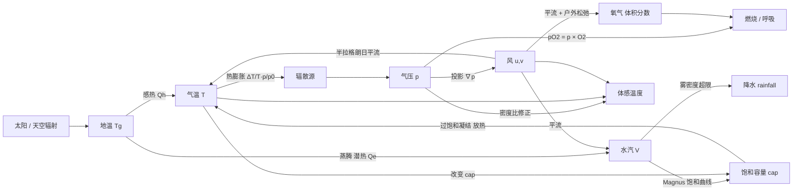

# Atmosphere Overhaul 元素耦合模型分析

> **分析对象**：Atmosphere Overhaul 1.7，`AtmosphereOverhaul.dll`，MVID `4e9f1eae1c1d40e48ce779113df84ba7`（694 类型 / 3343 方法 / 15 命名空间）。
> **方法**：DecompilerServer 反编译 `LocalAtmosphereEngine`、`LocalAtmosphereSettings`、`AtmosphereThermodynamicKernel`、`AtmosphereGroundEnergyKernel`、`AtmosphereMapComponent`、`AtmosphereInterface`、`VacuumEnvironment`、`FeelsLikeTemperature`、`Patches.FireOxygen`、`Plants.SoilWaterMapComponent` 等类型；对照 Weller (2012, MWR 140:3220–3234) 原文。
> **目的**：厘清温度、气压、气流、湿度、氧气、自定义气体、土壤含水量七个元素在 AO 中的真实耦合关系，并据此判断本 patch 的干预点是否落在正确的位置。
> **日期**：2026-11-11。

---

## 0. 结论摘要

AO 本地不是一个“七元耦合的物理模型”，而是：

1. **一台二维浅层可压缩投影求解器**——预报温度、气压、风，并把三者约束在一起；
2. **一个相变核**——只在温度与湿度之间做文章。

氧气、自定义气体是**被动标量**；土壤含水量是**外部源汇边界**。它们会被风搬运、被温度影响，但基本不反过来改写动力核心。

这个不对称性是理解 AO 所有“奇怪行为”的钥匙：**能改写闭环内部的只有温度、气压、风、水汽/雾四个量；其余量都在闭环外面。**

---

## 1. 七个量的角色分层

| 量 | 场 / 表示 | 物理角色 | 主要写入者 |
|---|---|---|---|
| 温度 T | `Temperature`（float / 格，℃） | 热力学状态 | 相变核、地面能量核、绝热项、半拉格朗日平流 |
| 气压 p | `Pressure`（solver 单位）+ `StoredPressurePa`（相对环境压的偏离，Pa） | 动力学约束（拉格朗日乘子） | 压力投影、热膨胀源、墙漏、等容基线 |
| 气流 u,v | `VelocityX` / `VelocityZ`（格心，m/s） | 动量与输运载体 | 投影修正、科氏、环境风 nudge |
| 湿度 | `Moisture`（水汽，hPa·cell 量级）/ `Mist`（雾）/ `RelativeHumidity`（诊断） | 唯一的相变量 | 相变核、平流、植物与呼吸通量 |
| 氧气 | `Oxygen`（`ByteAtmosphereField`，0–100 体积 %） | 被动标量，仅在消费端有分压语义 | 氧平流、户外松弛、呼吸与光合 |
| 气体 | `AtmosphereGasState.Density[]`（每种气体一个密度场） | 被动示踪剂，不反馈热力学 | 气体 worker、体积源 |
| 含水量 | `SoilWater`（mm，独立 `MapComponent`）+ `LocalRainfall` | 外部储库与源汇 | 蒸腾、灌溉、水位、裸土蒸发 |

七类量并不平级：只有温度与气压是“状态”，气流是“输运”，湿度是“相变”，其余都是乘客或外部边界。



---

## 2. 主循环：两步，不是七步

每个模拟 tick 只有两次调用（`LocalAtmosphereEngine.Tick`）：

```csharp
AdvanceProvisional(settings);   // 预测步
ProjectAndFinalize(settings);   // 投影 + 收尾
```

### 2.1 预测步 `AdvanceProvisional`

顺序固定，不能乱：

```
UpdatePressureMode
DiffuseVelocity
AdvectVelocity(dt, ambientWindEast, ambientWindNorth, ambientNudgeFraction)
ApplyCoriolis(CoriolisParameter, dt)
[爆炸压力残余：扩散 + 阻尼]
BeginScalarConservation
LimitScalarTraceToWalls(dt)
AdvectScalar(Temperature, dt)
AdvectScalar(Moisture, dt)
AdvectScalar(Mist, dt)
AdvectOxygen(dt, OxygenPercent, OutdoorOxygenRelaxation)
RestoreWindAfterScalarTransport
EndScalarConservation
DiffuseScalar(Temperature, TemperatureDiffusion, ScalarDiffusionIterations)
DiffuseScalar(Moisture, MoistureDiffusion, ScalarDiffusionIterations)
DiffuseOxygen(GasDiffusion, GasDiffusionIterations, OxygenPercent)
BeginPhaseChangeCapture
UpdateHumidityAndThermodynamics      ← 唯一的温度↔湿度交汇点
ClampThermodynamicFields
EndPhaseChangeCapture
```

即：动量（扩散 → 平流 → 科氏）→ 标量（平流 → 扩散）→ 相变。

### 2.2 投影步 `ProjectAndFinalize`

```
RefreshSealedRoomsIfNeeded
AddPressureOdditySources
if (compressibleActive) AddThermalExpansionSources
if (compressibleActive) AddWallLeakSources
Project(PressureIterations, PressureAccelerationScale, settings)   ← 解压力、修正速度
DampVelocity(VelocityDamping)
ApplyOpenBoundarySponge            （反编译为空方法）
EnforceBoundaries
ApplyThermodynamicPressureBaseline
ApplyExplosionPressureResidue
EnforceBoundaries
ClampVelocityMagnitude(MaxWindSpeed)
ClampVentVelocities
if (compressibleActive) ImprintChokedJets(MaxWindSpeed)
ApplyPressureOddityRealized
```

这是经典的 **Chorin 投影法**：先让速度自由演化（会“产生”散度），再解压力泊松方程把散度压回去。

> **核心认识**：压力不是被预报的量，而是为了满足散度约束而解出来的**拉格朗日乘子**。

---

## 3. 温度 → 气压：两条互斥的路

这是 AO 最容易被误读的地方。同一个 mod 里有两套完全不同的温度-气压耦合，由 `CompressiblePressure` 开关二选一。

### 3.1 路径 A：可压缩模式（`CompressiblePressure > 0`）

温度升高不直接改压力，而是先变成**体积膨胀**（`NoteThermalExpansion`）：

```csharp
thermalExpansion[index] += deltaCelsius / T_K * (p_abs / 100000f);
```

再由 `AddThermalExpansionSources` 换算成速度散度源：

```csharp
externalDivergence[i] += thermalExpansion[i] / (TimeStep * PressureAccelerationScale);
```

该源进入压力方程右端 `rhs`，解出的压力再通过绝热项反作用于温度。形成闭环：

> 加热 → 空气膨胀 → 产生辐散 → 压力变化 → 绝热降温 → 温度回落

这本质上是把声波/重力波隐式化。它对应真实大气的“热低压”：地面加热，空气膨胀上升，近地面气压降低，四周空气辐合。

AO 没有垂直速度，“上升”只能表现为**水平辐散**——这是二维浅层模型的必然妥协。

### 3.2 路径 B：不可压模式（`CompressiblePressure <= 0`）

没有热膨胀源，压力由 `ApplyThermodynamicPressureBaseline` 直接算：

```csharp
p_abs = AmbientSurfacePressurePa * (T_K / T_ambient_K) + stored + oddity;
```

这是**等容加热**：`p/T = const`。对应“密封刚性盒子被加热”的极限，不是自由大气。

官方 Steam 页所说的“密封房间起火、压力升高直到把门顶开”，走的就是这条。

> **同一股热空气，在可压缩模式下表现为“膨胀 → 低压 → 涌风”，在不可压模式下表现为“升压 → 顶门”。两套行为都物理自洽，但发生在不同极限里。patch 若只假设其中一套，换设置就会失效。**

---

## 4. 气压 → 温度：泊松绝热，但不是教科书那个指数

`StoreCompressiblePressure` 逐格计算：

```csharp
float ratio = 1f + (p_new - p_old) / p_old;          // 相对压力变化
float T_K   = Temperature.Read[j] + 273.15f;
float scale = Mathf.Min(1f, p_abs / 100000f);        // 低压时衰减
float dT    = T_K * (Mathf.Pow(ratio, 0.4f * adiabaticFactor * scale) - 1f);
```

真实干空气的泊松指数是 `R/cp = 2/7 ≈ 0.2857`。AO 用 `0.4 × CompressibleAdiabaticFactor × min(1, p/1e5)`：

- `0.4` 是上限，实际靠 `factor` 调到 0.29 附近；
- `min(1, p/1e5)` 意味着**压力低于 1 atm 时绝热效应被线性削弱**——稀薄大气里压缩生热不那么剧烈。

随后 `ConserveAdiabaticHeat` 做一次全局热量再分配，避免逐格升温凭空增加总能量。这是 AO 少数几个显式的守恒修正之一。

物理含义：压缩升温、膨胀降温。这是“放气制冷”“压缩生热”“山谷下沉增温”的数值来源。

---

## 5. 气压 → 风：投影，加上“每个面的开度”

`Project` 的核心是三步：算散度、解压力、修正速度。

### 5.1 散度（面开度加权）

`FaceOpenX/Z` 是 0..1 的透气率：

```csharp
divergence[i] = (-0.5f * (u_right * openRight - u_left * openLeft
                        + v_up    * openUp    - v_down * openDown)
                 + externalDivergence[i]) * ObstacleMask[i];
```

### 5.2 压力方程

不可压时是加权 Jacobi：

```csharp
p[i] = (div[i] + Σ_neighbor p_neighbor * open_face) / Σ open_face;
```

可压缩时多两项：

```csharp
alpha * (p[i] - p_prev[i]) + beta * p[i] - ∇·(open ∇p) = rhs;
```

其中：

- `alpha = 1.2 / (dt² · h · 1e5)`：**可压缩“储能”**。alpha 越小越接近不可压；
- `beta = (RoofMask <= 0.5) ? sky : 0`：**只有露天格与“天空”耦合**，有顶格 beta = 0。

`beta` 是理解室内外差异的关键：露天格压力被天空“钉”在环境压附近；室内格没有这个钉扎，只能靠 `alpha` 慢慢储能。所以室内能憋住压力、室外几乎瞬间回到环境压。

`skyPinCells` + `PinSkyPressure()` 会把某些“天空连通组件”整块钉为 0（相对环境压），防止漂移。

### 5.3 速度修正

面加权梯度，再乘开度：

```csharp
u[i] -= acceleration * (Σ (p_neighbor - p[i]) * open) / Σ open;
u[i] *= FaceOpenX[i];
```

`FaceOpen = 0` 的面完全不传导（墙），`FaceOpen > 0` 才透气（门、缝、破口）。

> **这就是 AO 的“几何”**：它不追踪墙的形状，只维护一张“每个面透不透气”的标量图。

### 5.4 边界

- `ZeroPressureBoundary`：地图四条边压力置 0（相对环境压）；
- `EnforceVelocityBoundary`：边界格速度 = `OpenEdge ? 环境风 : 0`，切向分量取自内侧邻格；
- `ApplyOpenBoundarySponge`：反编译为**空方法**；
- `CopyOpenBoundary`：把边界值复制到幽灵格。

---

## 6. 风 → 标量：半拉格朗日，只对露天格加环境风

### 6.1 标量平流

温度、水汽、雾都用同一套半拉格朗日回溯：

```csharp
TraceBackward(i, z, vx, vz, dt, out pastX, out pastZ);
target[i] = BilinearSampleOpenAir(source, pastX, pastZ, source[i]);
```

无条件稳定，但数值扩散很强——低速区会被抹平。这是 AO 温度场看起来“糊”的原因之一。

实心格保持原值（`target[i] = source[i]`），标量不能穿墙，但可以随风流绕过墙。

### 6.2 环境风只推动露天格

```csharp
if (ambientWind != 0 && RoofMask[i] <= 0.5f)   // 只有露天格
    v += (ambientWind - v) * ambientNudgeFraction;
```

室内的风只能从门、缝、透气面“渗”进来，再靠压力梯度和粘性扩散传播。这解释了为什么 AO 里室内几乎无风、开门瞬间会有穿堂风。

### 6.3 氧气

氧是独立的 byte 场，单独半拉格朗日平流，并在露天格向 `OxygenPercent` 按 `OutdoorOxygenRelaxation` 松弛。

---

## 7. 温度 ⇄ 湿度：唯一的相变闭环

全部集中在 `AtmosphereThermodynamicKernel.Advance` 一个函数里，按顺序做六件事：

1. **开阔水面蒸发**：`(cap - V) * EvaporationRate * windFactor * pressureFactor * WaterMask * dt`，吸热降温；
2. **雾滴蒸发**：不饱和时雾 → 水汽，吸热；
3. **过饱和凝结**：`V > cap * supersaturationRatio` 时水汽 → 雾，放热；
4. **降水**：雾密度超过 `MaxMistDensity` 的溢出部分；
5. **露天雾消散**：指数衰减；
6. **数值下限**：雾小于 `MistNumericalFloor` 时归零并计入降水。

### 7.1 饱和容量（Magnus-Tetens）

```csharp
cap = VaporCapacityBase * exp(A * T / (B + T));
```

标准形式为 `e_s = 6.112 * exp(17.62 T / (243.12 + T))` hPa。`B + T` 中的 `T` 是摄氏温度，属 Magnus 公式常见写法。

### 7.2 两个约束

- **潜热预算**：`MaxLatentHeatTemperatureDeltaCelsius` 限制单步内相变能改变的温度总量，防止“一帧之内全部凝结/蒸发”；
- **压力因子**：`pressureFactor = clamp(1e5 / p, 1, max)`。**气压越低，蒸发越快**——这是气压对湿度的唯一直接作用。

### 7.3 因果链

> 温度 → 饱和容量 → 蒸发/凝结 → 潜热 → 温度（闭环）
> 气压 → 蒸发速率（单向）
> 风 → 蒸发速率 + 平流（单向增强）

### 7.4 一个反直觉的设计

**降水是“雾太浓”的溢出，不是水汽直接凝华。** 水汽必须先过饱和变成雾，雾密度超过阈值才“掉下来”。这意味着 AO 的雨一定伴随能见度下降，“局部强降雨”在数值上表现为“局部雾极浓”。

### 7.5 边界排除

`UpdateHumidityAndThermodynamics` 的循环范围是 `i ∈ [1, Width-1)`、`z ∈ [1, Height-1)`，**地图最外一圈不参与相变**。实心格直接清零水分、雾、RH、降水。

---

## 8. 氧与气体：被动乘客

### 8.1 氧

氧气是独立的 byte 场（0–100 体积百分比），单独平流 + 户外松弛。它**不参与压力方程，也不参与温度方程**。

唯一“耦合”的地方在消费端（`Patches.FireOxygen.Factor`）：

```csharp
oxygenKPa = pascals * percent * 0.01f * 0.001f;   // pO2 = p_total × O2 体积分数
factor = Mathf.Min((oxygenKPa - 13f) / 8.29999f, 3f);
```

- 火在 pO2 < 13 kPa 时熄灭；
- 海平面 pO2 ≈ 21.2 kPa，因子约等于 1；
- 富氧最多把燃烧加速到 3 倍。

呼吸走 `HediffGiver_OxygenSubpressure` 与 `StatPart_OxygenDelivery`（`Breathing × BloodPumping`）。

> 真空里 O2% 仍然是 21，但 pO2 = 0，人照样窒息——这是正确的物理。

### 8.2 自定义气体

每种气体一个 `Density[]` 场，被动平流、扩散、消散，带 `maxDensity`、`harmfulDensity`、`blocksVision`、`shootObscuranceFactor` 等消费端参数。

`AtmosphereGasStorageMode`：

- `ManagedScalar`：AO 自管标量密度场；
- `VanillaGasGridBridge`：桥接原版 `gasGrid`。

`AtmosphereGasDef.backingVanillaGasType` 用于桥接原版气体类型。

### 8.3 一个例外

`MixReleasedGasAt` 这类“释放气体”的入口会同时改体积（升压）、氧百分比和温度。

也就是说：**气体本身不参与状态方程，但“释放气体”这个动作会。** 这与真实世界“往密闭空间充气会升压”一致，只是 AO 把它做成显式的体积源，而非气体的分压贡献。

---

## 9. 地温与土壤水：外部边界，不是动力核心

### 9.1 地面能量核 `AtmosphereGroundEnergyKernel.Advance`

AO 里最像“气象”的一段：

```
净辐射 = 短波 (1-反照率)(1-冠层遮荫)
       - 长波 (Tg - 天空辐射温度)
       - 与外部气温的耦合
地温 += 净辐射 * 热惯量 * dt
地→气感热 = (Tg - Ta) * GroundAirConductionRate * dt
屋顶：吸收太阳 → 加热屋顶下空气；与外部气温耦合
蒸腾：airDelta -= transpiration * LatentHeatPerUnit
```

注意屋顶的处理：**有顶格不接收直射太阳**（`sunIn = roofed ? 0 : ...`），但屋顶本身会吸热并加热屋顶下的空气。这对应“铁皮屋顶白天烤人”。

恒温地面（`groundMinimum == groundMaximum`，如地热/深渊）跳过辐射计算。

### 9.2 土壤水 `SoilWaterMapComponent`（单位 mm）

- `ApplyFluxes` 每帧把植物“白天耗水”从 `soil[i]` 扣掉，换算成水汽加进大气，同时按潜热降温；
- `AddBreathing` 每 60 tick 扫一遍所有会呼吸的 pawn：耗氧、产水汽，**室内因子 1.0、户外 0.01**（户外几乎瞬间被稀释）；
- `AddWater` 由灌溉器（`CompIrrigator.ApplyDoses`）与浇水 job（`JobDriver_WaterPlants`）调用；
- 水位：`NearWater`、`WaterTableFraction`、`WaterTableRadius`、`AlwaysWet`、`IsWaterTerrain`；
- 裸土蒸发：`BareSoilEvaporationMmPerDay`。

### 9.3 植物

`PlantGasExchange.AirFactors` 的字段是 `Oxygen`、`Pressure`、`Vpd`、`Soil`、`Product`。

> **植物生长因子 = 氧 × 气压 × VPD × 土壤水的乘积。**

### 9.4 一个缺口

降水写进 `LocalRainfall` 场，但 `SoilWaterMapComponent.AddWater` 的调用者只有**灌溉器**和**浇水 job**，没有降水。

也就是说：**AO 的“降水 → 土壤水”这一环在代码里是不闭合的。** 土壤水靠水位/邻水/抽水泵补给。这可能是设计取舍，也可能是遗漏——但它直接影响“人工降雨”“干旱农业”这类玩法的可行性。

---

## 10. 与真实气象、与 TRiSK 的对照

Weller (2012) 讲的是 **TRiSK**：任意正交结构网格上的 C-grid 有限体积。关键特征是**交错存储**——法向速度在边上，质量/PV 在格心，边与格心的自由度比例必须精确，否则会出现计算模。

六边形网格速度自由度过多，长出一支**虚假的 Rossby 波**，表现为格点尺度的 PV 振荡。解法是用**迎风偏置的 PV 插值**（LUST/CLUST）压掉这些模，并用 checkerboard 指示函数诊断：

```
I_i = 1   当 sign(∇²q_i) 与所有邻居相反
```

这是“格点尺度奇偶振荡”的判据。

### 10.1 AO 不是 C-grid

AO 的散度是这么算的：

```csharp
div = 0.5f * (vx[i] + vx[i+1]) * FaceOpenX[i] - 0.5f * (vx[i-1] + vx[i]) * FaceOpenX[i-1] + ...
```

如果速度存在面上，就不需要对 `vx[i]` 与 `vx[i+1]` 取平均。这个 `0.5 * (…)` 说明**AO 的速度存在格心，面通量是插值出来的**——它是 collocated 有限体积，不是 C-grid。

Weller 论文也正好提到：collocated finite volumes 的精度不如六边形 C-grid（Weller et al. 2009）。

### 10.2 对照表

| | Weller 2012 / TRiSK | AO 本地实现 |
|---|---|---|
| 网格 | 任意正交，六边形为主 | 规则 Cartesian 二维 |
| 速度存储 | 边上（交错） | 格心（collocated） |
| 质量 / PV | 格心，局部守恒 | 格心标量，半拉格朗日平流 |
| 计算模 | 虚假 Rossby 模 | collocated 的棋盘压力模 |
| 抑制手段 | PV 迎风插值（CLUST） | 面开度加权、`CancelWallNormalOneSidedGradient`、`skyPin`、Jacobi/SOR 平滑 |
| 局部守恒 | 质量、PV 严格局部守恒 | 无严格局部守恒，靠 `ConserveAdiabaticHeat` 等做全局修正 |

### 10.3 结论

**作者引 Weller 是“方法谱系”上的致敬**（C-grid、有限体积、用迎风控制计算模），但 AO 并没有实现 TRiSK，也不能继承 TRiSK 的局部守恒和地转平衡性质。

AO 实际面对的是 collocated 网格的奇偶失耦——这解释了为什么它需要 `CancelWallNormalOneSidedGradient` 这种“补丁式”的梯度修正，也解释了为什么压力场在某些几何下会出现棋盘纹理。

### 10.4 抓住了什么、替代了什么、缺了什么

**抓住了**：

- 状态方程的两种极限（定压膨胀 / 定容升压）；
- 泊松绝热；
- Clausius-Clapeyron + 潜热；
- 地表能量平衡（短波 / 长波 / 感热 / 潜热 / 冠层）；
- 投影法动量方程；
- 科氏力；
- 壅塞流（choked flow）；
- 氧分压。

**替代了**：

- 垂直方向 → 散度源；
- 云 → 雾；
- 雨 → 雾密度溢出；
- 辐射 → 单波段 + 天空温度；
- 对流 / 锋面 → 外部天气系统叠加；
- 地形 → 二维面开度图。

**缺失**：

- 垂直速度与静力平衡；
- 云微物理与冰相；
- 辐射传输与温室气体；
- 气体对热力学的反馈；
- 降水入渗土壤；
- 真正的“三维环流”。

---

## 11. 对 patch 的三条直接结论

### 11.1 压力单位不是常数

`AddPressureDelta` 收的是 solver 单位，换算靠 `SolverPascalsPerUnit(settings)`：

- 不可压：`AtmosphereColorUtility.CurrentSolverPressureToPascals()`（1000 Pa / 单位）；
- 可压缩：`PressureAccelerationScale * 1.2 / TimeStep`——**随设置变**。

patch 里如果写死“1 单位 = 1000 Pa”，在玩家把可压缩打开后就会错一个量级。

### 11.2 不可压模式下，压力每步被温度基线重算

`ApplyThermodynamicPressureBaseline` 在 `Project` 之后写 `Pressure.Read`。直接加压力增量只有在走 oddity 通道时才不会被下一步抹掉。

这是“补丁加压时灵时不灵”的结构性原因。

### 11.3 氧是体积分数，不是分压；降水不回灌土壤

任何“补氧”“造雨”的兼容逻辑都必须：

- 自己乘总压得到 pO2；
- 自己写土壤水，AO 不会替你闭合这两环。

---

## 12. 判断 patch 干预点的标准

> AO 的气象感来自“温度—湿度—气压—风”这个四元闭环；氧、气体、含水量都是挂在它外面的边界条件。

因此审视 patch 时，判断标准是：

- 这个补丁是在闭环**内部**动手？（会被求解器放大或抹平）
- 还是在**边界**上动手？（更可控，但影响有限）

具体的落点：

| patch 模块 | 干预的层 | 风险 |
|---|---|---|
| `Compat.GoodClimate` | 透气面开度（`FaceOpen` / `CompAirVent.speedLimit`） | 改的是几何阻抗，落在闭环内部；恢复时机必须与 `SimulationIntervalTicks` 对齐 |
| `Compat.CentralizedClimateControl` | 真空判定读 AO 气压 + 通风 | 只读，安全；但 `Room.Vacuum` 与 AO 压力场是两套表示 |
| `Compat.VanillaTemperatureExpanded` | 温控类 | 若直接写 `Room.Temperature`，会走 AO 的整房间平移钩子，丢空间结构 |
| `Compat.OmniCrafter` / `ForceFieldStabilizer` | `AddDeltas` 强制稳定 | 每步叠加会过冲；大 delta 触发 `PatchSafeDivergence` 限幅 |

---

## 附录 A：证据锚点

| 行为 | 类型 / 方法 |
|---|---|
| 主循环 | `LocalAtmosphereEngine.Tick` / `AdvanceProvisional` / `ProjectAndFinalize` |
| 压力投影 | `Project(iterations, pressureAccelerationScale, settings)` |
| 可压缩求解 | `SolveCompressible` / `CompressibleSetupPass` / `CompressibleSorPass` / `CompressibleSweepPass` |
| 绝热升温 | `StoreCompressiblePressure` + `ConserveAdiabaticHeat` |
| 热膨胀→散度 | `NoteThermalExpansion` / `AddThermalExpansionSources` |
| 等容升压 | `ApplyThermodynamicPressureBaseline` |
| 墙漏 | `ApplyWallLeakage` / `AddWallLeakSources` / `WallLeakBuilder` |
| 标量平流 | `AdvectScalar` / `AdvectVelocity` / `AdvectOxygen` |
| 相变核 | `AtmosphereThermodynamicKernel.Advance` |
| 地面能量 | `AtmosphereGroundEnergyKernel.Advance` / `ApplyGroundEnergy` |
| 氧分压 | `Patches.FireOxygen.Factor` |
| 体感温度 | `FeelsLikeTemperature.Celsius` / `HeatIndexDelta` |
| 真空 | `VacuumEnvironment.LocalPressureRatio` / `IsVacuumMap` / `Grip` |
| 土壤水 | `Plants.SoilWaterMapComponent.ApplyFluxes` / `AddBreathing` |
| 植物 | `Plants.PlantGasExchange.AirFactors` |
| 气体 | `Gases.AtmosphereGasManager` / `AtmosphereGasState` / `AtmosphereGasDef` |
| 公开 API | `RimWorld.AtmosphereInterface`（读 / 写 / 源 / 空气泵四大类） |

## 附录 B：未确认项

以下内容尚未从 IL 中读出确切值，使用时需谨慎：

1. `LocalAtmosphereSettings.Default` 的具体数值（`TimeStep`、`PressureIterations`、`CompressiblePressure` 默认是否开启、`MaxWindSpeed`、`SimulationIntervalTicks`）。`.ctor()` 反编译为空、`.cctor` 未定位，可能由 `AtmosphereTuningDef`（XML Def）在运行时加载。
2. `AdvectScalar` 是否严格半拉格朗日，还是迎风 + 限制器（`TryBurstPassiveAdvection` 的 Burst 实现未读）。
3. `skyPinCells` / `PinSkyPressure` 具体挑选哪些连通组件。
4. `ApplyOpenBoundarySponge` 为空方法是否由 Burst 版替代。
5. `LocalRainfall` 的最终消费者（降水是否只用于视觉 / 原版天气联动）。
6. `CancelWallNormalOneSidedGradient` 的具体公式（collocated 网格的棋盘抑制细节）。
7. `Patches.PatchSafeDivergence` 的实际限幅值。
